<div align="center">
  
  <h1>Clayprint</h1>
  <p><b>文字稿進去，每頁都有判斷、附上來源的簡報與報告出來。</b></p>
  <p>繁體中文 · <a href="README_EN.md">English</a></p>
  <a href="https://github.com/kerfnotes/skills/stargazers"></a>
  <a href="LICENSE"></a>
  
  <a href="https://youtu.be/dIQ2amlA6HY"></a>
</div>

<br/>

<div align="center">
  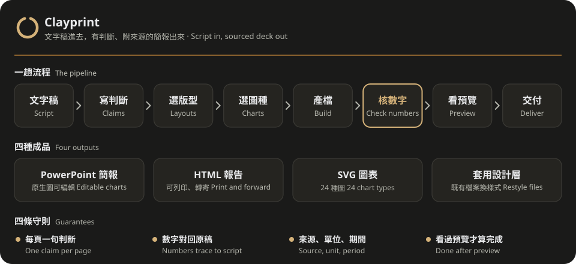
</div>

## 先選工作，再選交付

先辨認內容可以重組，還是只要換樣式。沿用已給的讀者背景、目的與格式，只有缺口會改變取捨時才詢問一次。

- **只換樣式**：沿用原文，在既有 PowerPoint、Word、Excel 或 HTML 的副本上修改指定圖表或圖片，保留原檔、頁序、公式與可編輯內容。擷取結果僅是可讀內容與圖表快取，不是完整往返重建模型；讀不到或只有快取時會揭露限制。見[既有檔案流程](references/formats.md)。
- **內容可重組**：有講者時做現場簡報；無講者、需逐頁比較證據時做閱讀版簡報；連續閱讀、轉寄或列印時直接做 HTML／PDF 報告。使用者明確指定的格式優先。

## 為什麼

AI 做簡報不難，難的是做出能拿去開會的簡報：每頁標題要是一句判斷，不是「背景」「分析結果」；圖上的數字要對得回原稿；頁尾要交代來源、單位與期間。Clayprint 把這些要求寫進流程與檢查程式，交給 Codex 或 Claude Code 跑。你給文字稿和用途，它交出 PowerPoint（原生圖可在 PowerPoint 裡改數字）、HTML 報告或 SVG 圖，並在交付前逐頁看過預覽。

介紹影片：[從需要，到自己的工具](https://youtu.be/dIQ2amlA6HY)（YouTube，8 分 39 秒），講 Clayprint 怎麼從一次次不滿意整理出來，也講怎麼檢查 AI 做出來的成品。

## 範例

三份示範稿都用公開資料，數字逐一對回一手來源，再由另一個模型獨立複核。以下圖片都由 `examples/showcase/` 直接產生，沒有手工修圖。

**AI 伺服器出口潮與台灣經濟**（決策型，[文字稿](examples/showcase/ai-exports.md)・[story.json](examples/showcase/ai-exports.json)）：財政部海關統計、主計總處

| | |
| --- | --- |
| 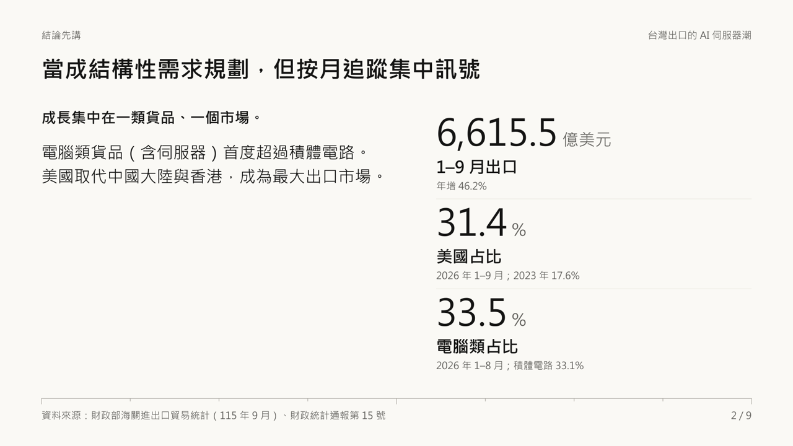 | 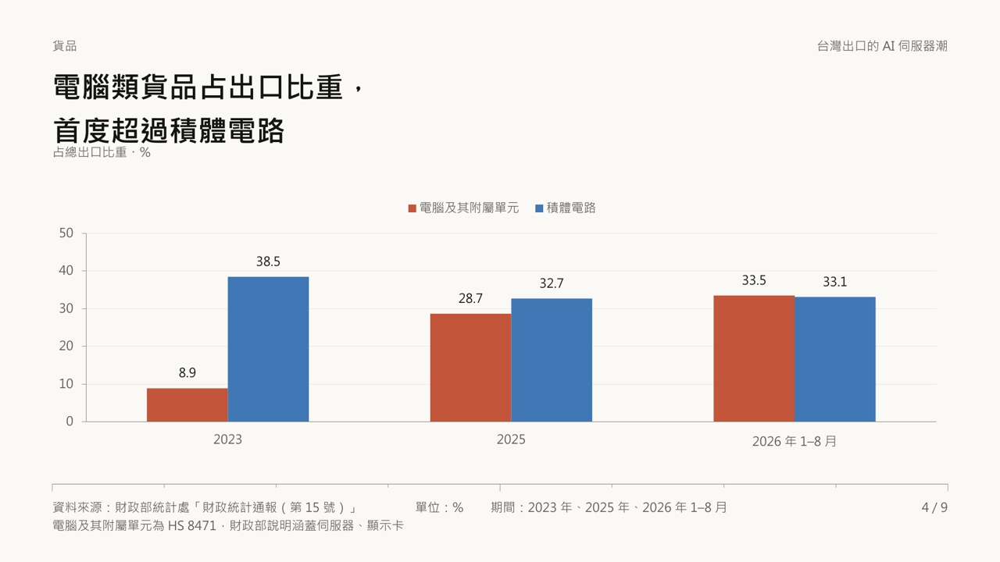 |
| 主管摘要：左邊建議，右邊三個支撐數字 | 分組長條：電腦類貨品首度超過積體電路 |
| 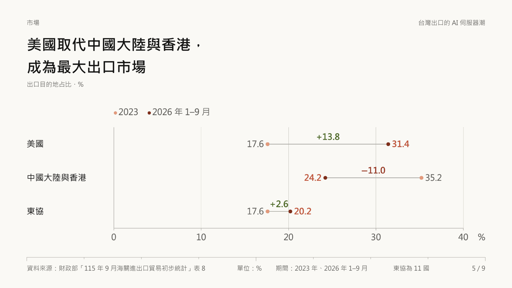 | 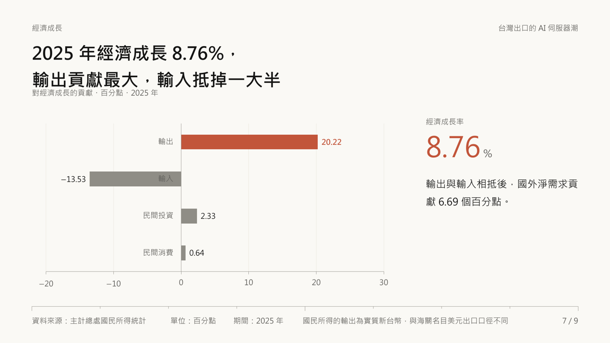 |
| 啞鈴圖：兩期占比與差距 | 正負長條：輸出貢獻最大，輸入抵掉一大半 |

**颱風假怎麼決定**（說明型，[文字稿](examples/showcase/typhoon-day.md)・[story.json](examples/showcase/typhoon-day.json)）：天然災害停止上班及上課作業辦法

| | |
| --- | --- |
| 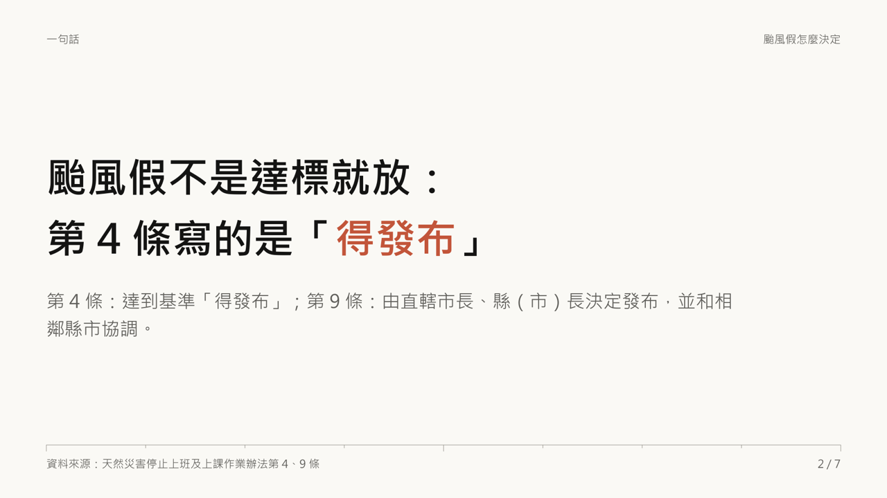 | 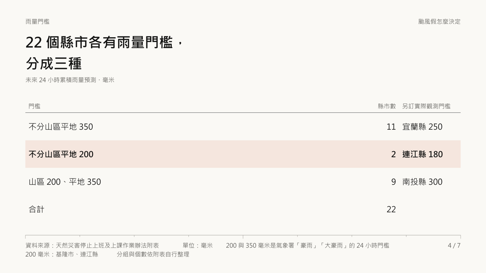 |
| 沒有數據時，先用一句話記住判斷 | 表格：22 個縣市的雨量門檻 |
| 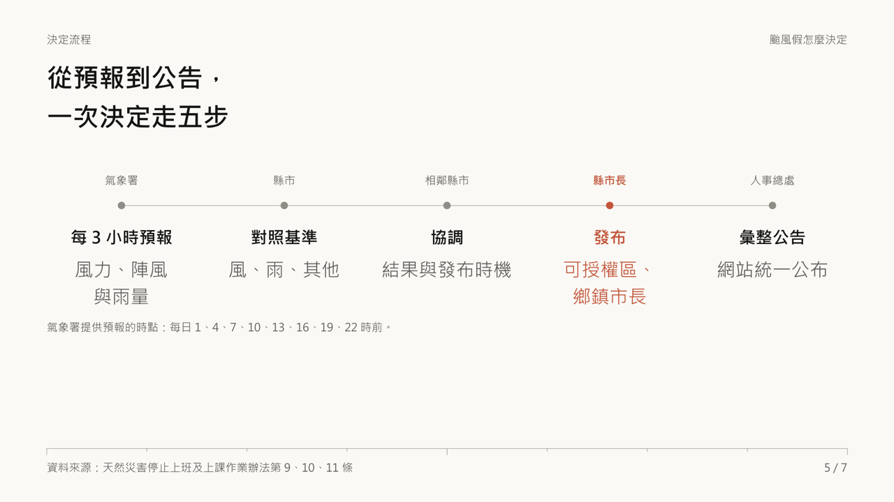 | 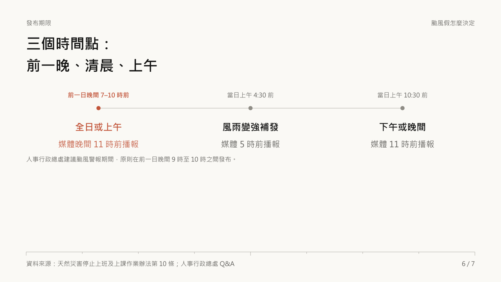 |
| 流程：標出拍板的那一步 | 三個發布期限 |

**全球能源轉型**（圖表展示，[文字稿](examples/showcase/energy.md)・[story.json](examples/showcase/energy.json)）：Ember、IEA（CC BY 4.0）

| | |
| --- | --- |
| 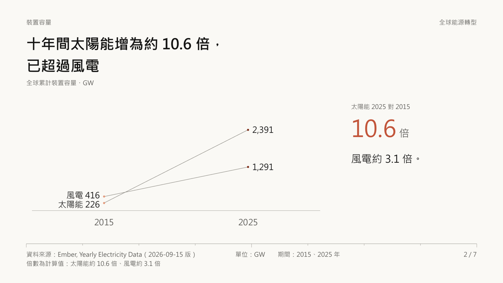 | 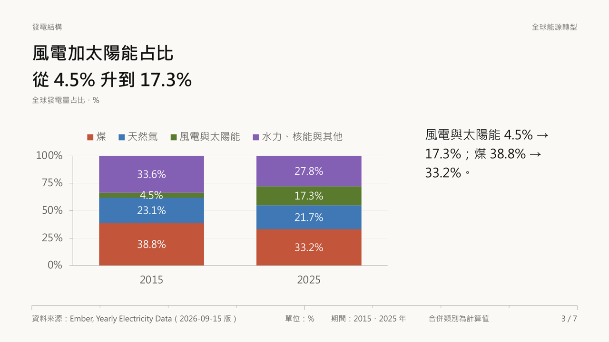 |
| 斜線圖：兩期的交叉 | 占比堆疊：發電結構的變化 |
| 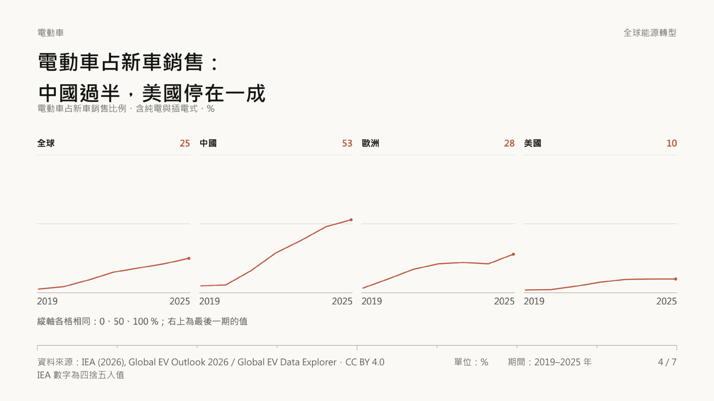 | 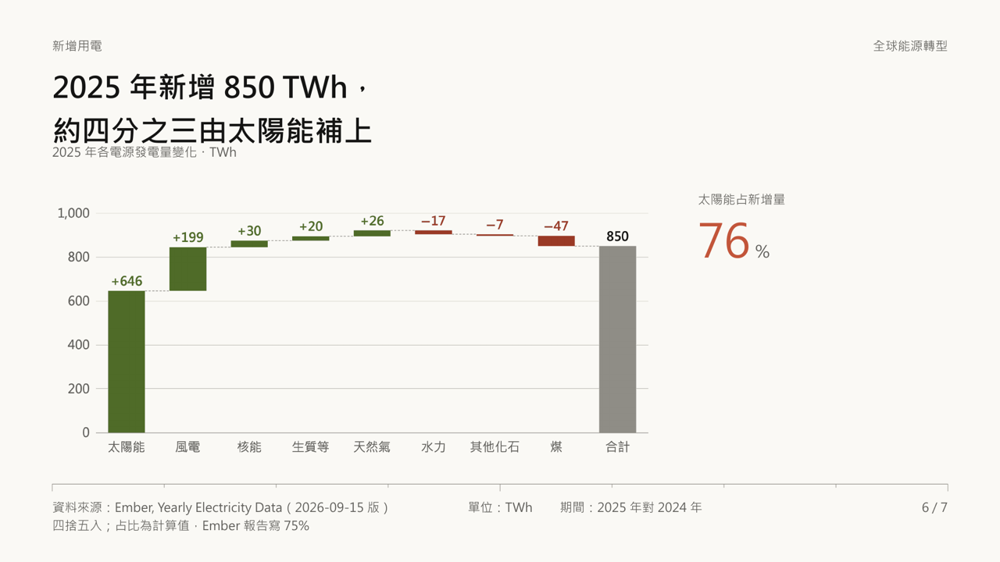 |
| 小倍數：共用縱軸，各看各的走勢 | 瀑布圖：新增用電從哪裡來 |
| 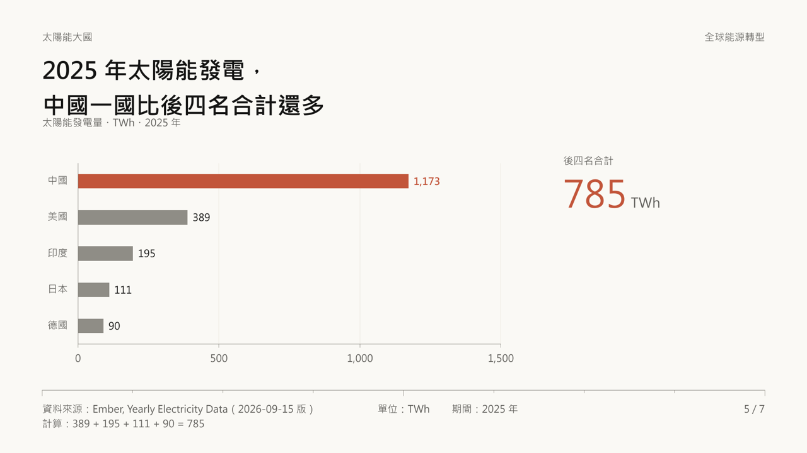 | 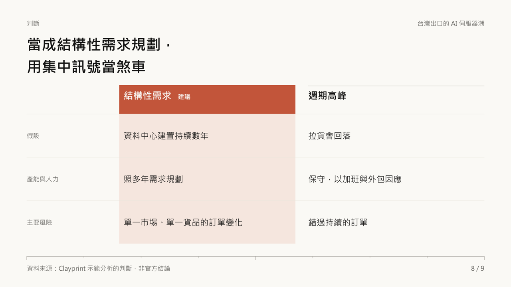 |
| 排名長條：右側放計算出的重點數字 | 方案比較：建議欄整欄標色（AI 那份第 8 頁） |

同一份 AI 出口稿也能做成 HTML 報告（[ai-exports-report.html](examples/showcase/ai-exports-report.html)），可以轉寄，也能印成 PDF：白紙學者版心、圖表的「圖 N」與標題在上、註與來源在下，每頁有頁尾頁碼，章節在頁中接續。


示範稿只整理公開數字，不構成投資或政策建議；查核日 2026-10-22，之後官方修正的數字不會自動更新。要自己重現，安裝後執行：

```sh
node evals/check.mjs examples/showcase/energy.json examples/showcase/energy.md
node scripts/pptx.js examples/showcase/energy.json out/energy.pptx
node scripts/preview.js out/energy.pptx out/energy
node scripts/pdf.js examples/showcase/ai-exports-report.html out/ai-exports
```

## 它怎麼把關

| 環節 | 做什麼 | 由誰負責 |
| :--- | :--- | :--- |
| 寫判斷 | 每頁先寫一句能被內容支持的 `claim`，再挑能撐住它的版型；撐不住就換版型或刪頁 | `SKILL.md`、[layouts.md](references/layouts.md) |
| 選圖種 | 24 種圖依「要回答什麼問題」分組：排名、趨勢、組成、分布、敏感度、關係、流失、逐格查 | [charts.md](references/charts.md) |
| 核數字 | 畫面上每個數字都要出現在原稿，或寫成同頁可核對的加減算式；找不到就擋下 | `evals/check.mjs`、`evals/check-report.mjs` |
| 估容量 | 依設計層字寬估算每格放不放得下，警告孤字與溢出，不自動縮字 | `scripts/pptx.js` |
| 看預覽 | 用 PowerPoint 或 LibreOffice 輸出每頁 PNG 與整份概覽，逐頁看主張、強調與閱讀順序 | `scripts/preview.js` |
| 印報告 | 用 Chrome、Edge 等瀏覽器把報告印成 PDF，警告填滿率不足、圖表被切開與右側溢出 | `scripts/pdf.js` |

交付分開回報四層證據：程式核對、實際預覽、PowerPoint 原生圖表編輯及目標讀者理解。程式只核對支援的結構、原稿數字及容量診斷，不是完整事實查核；預覽須記錄軟體與觀看條件，原生編輯須實際在 PowerPoint 改數值。沒有目標讀者回饋時只回報內容檢視，理解仍標未驗；缺少工具或觀看條件時保留已完成產物並列明受阻或未驗項目。見[交付證據](SKILL.md#交付證據)。

## 怎麼一起工作

交給 AI 時，連同文字稿說明背景：給誰看、要支持什麼判斷或決定。同一份稿，目的不同，取捨也不同。

| 片中說法 | 對應檔案 | 什麼時候改 |
| --- | --- | --- |
| 給 AI 的指引 | `SKILL.md`、`references/` | 用途、內容流程、支援範圍改變時 |
| 設計設定 | `design/tokens.json`、`design/brief.md` | 改顏色、字型、字級、間距、線寬時 |
| 程式 | `scripts/` | 改圖種、版型或輸出方式時 |
| 檢查成品 | `tests/`、`examples/`、`evals/` | 發現新問題或需要新範例時 |

簡報由 `scripts/pptx.js` 讀 `story.json` 與設計層；報告由 `scripts/report.js` 讀 `report.json` 與設計層，再由 `scripts/pdf.js` 印成 PDF；SVG 另讀圖表 JSON 與設計層。換外觀或改流程，見[改造步驟](docs/make-it-yours.md)。

## 交給 agent 安裝

把這段交給 Codex 或 Claude Code：

```text
請把 https://github.com/kerfnotes/skills 裡的 Clayprint（skills/kerf-clayprint）安裝到目前專案。
先讀 skills/kerf-clayprint/docs/install.md，依目前使用的 agent 選擇安裝路徑，
自行完成環境檢查、套件安裝與範例驗證，回報安裝路徑、版本及驗證結果。
```

需要 Node **22.7.0 以上**，不需要 API key 或額外建置。Codex 的專案路徑是 `.agents/skills/kerf-clayprint/`；Claude Code 是 `.claude/skills/kerf-clayprint/`。整個 `skills/kerf-clayprint/` 資料夾就是 skill，需保留 `SKILL.md`、`scripts/`、`references/`、`design/` 等檔案。[agent 安裝指引](docs/install.md)說明下載、重複安裝、缺少 Node 時的做法，以及產檔與整頁預覽的驗收條件。

也可以用 [`skills`](https://www.npmjs.com/package/skills) CLI 從整個 repo 挑：

```sh
npx skills add kerfnotes/skills --list
```

## 開始使用

安裝完成後直接說：

```text
用 Clayprint 把這份文字稿做成簡報，給主管決定要不要擴大試行
把這份會議紀錄做成 HTML 報告，要能列印
把這份稿子做成會前閱讀版簡報，大家先自己看，不會有人講解
```

閱讀版簡報字級較小（標題 22 pt、正文 11 pt），每個內容頁以 600–900 字元作密度參考，可並排兩格、加結論句與註腳，要說的話直接寫在頁面上，見[閱讀型簡報](references/layouts.md#閱讀型簡報)與範例 [story-read.json](examples/story-read.json)。


字元範圍與低於 70% 的填滿提示都是診斷，不是必須達成的配額，也不代表理解程度。先查原稿已有的理由、定義或限制是否漏寫，再考慮併頁、拆分大元件或重排；內容完整且留白有助閱讀時記錄理由即可，只補原稿支持的必要內容。PDF 量最後一列墨水在版心內的位置，簡報則依版型估算內容自然高度；溢出、切頁與空白證據右欄等診斷仍保留。

解釋深度依已知先備知識調整：初學讀者在首次需要時得到術語說明，熟悉的讀者直接看證據與取捨；影響判斷的限制與結論留在同頁或同節。只換樣式時沿用原文。

Codex 也可用 `$kerf-clayprint`，Claude Code 可用 `/kerf-clayprint`。

## 已知限制

- [PowerPoint 編輯限制](docs/design-diff.md)：只有部分圖表能用「編輯資料」；SVG 圖表須改資料後重產。
- LibreOffice 預覽可能使用替代字型。PowerPoint 內的字型由設計層的 `font.slide` 決定（預設微軟正黑體）；字寬估算以正黑體校準，換字型後請看預覽確認換行，收件者電腦也要有該字型。
- 中文數詞與日期區間不自動核對，須回原稿人工查證。
- 數字檢查只確認畫面數字出自原稿，不確認原稿本身正確；原稿的數字仍要回一手來源查證。

授權：[MIT](LICENSE)。`examples/showcase/` 的資料來源與授權寫在各份文字稿的「來源」一節；`examples/` 其他範例為虛構示意資料，供測試使用。
