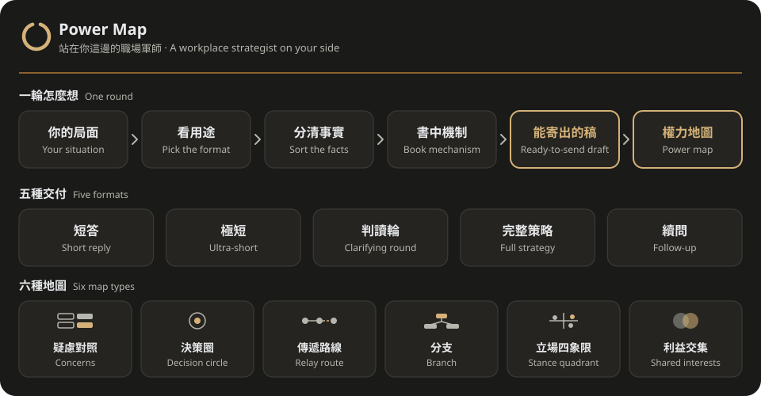

<div align="center">
  
  <h1>Power Map</h1>
  <p><b>A workplace strategist on your side: a draft you can send today, plus a map of why it works.</b></p>
  <p><a href="README.md">繁體中文</a> · English</p>
  <a href="https://github.com/kerfnotes/skills/stargazers"></a>
  <a href="LICENSE"></a>
  
  <a href="https://www.youtube.com/@kerfnotes"></a>
</div>

<br/>

<div align="center">
  
</div>

## Why

When work gets stuck, what you usually need is not an essay but an email you can send today or an opening line you can say in person. Power Map draws on the mechanisms and cases in *Power*, *Getting to Yes* and *The Dictator's Handbook* to turn your situation into advice and wording you can use directly, with a visual power map each round. The text says what to do; the map says why it holds and which step to take next.

## Three books, three jobs

| Book | The question it answers |
| :--- | :--- |
| *Power* | Where power comes from: resources, visibility, who depends on whom |
| *Getting to Yes* | How to negotiate: interests over positions, standards the other side accepts, a real fallback |
| *The Dictator's Handbook* | Whose support keeps the decision-maker in place, turned only into legitimate workplace moves |

The books are distilled into a nine-step method in three stages (read the board, choose the play, land it; see [method.md](references/method.md)). It ships 99 full stories from the books plus a 712-entry one-line case index. A story appears only when it separates two options, stating how it differs from your case and which option it supports.

## Purpose first, then length

| What you will do with it | What you get |
| :--- | :--- |
| Reply, ghost-write, answer a concern, write an explanation | **Short reply**: a ready-to-send draft, at most one reminder, a compact map; outside the draft, only what sending and deciding need |
| You asked for no long answer, or gave a word limit | **Ultra-short**: only the words to say and at most one reminder |
| The first step hinges on a fact you probably know | **Clarifying round**: up to three questions, plus a message you can send today and a branch map |
| You want the whole play, or need to compare paths | **Full strategy**: judgement and first step, a usable draft, the grounds and fallback |
| Progress update, follow-up, wrap-up | **Follow-up**: only the affected judgement, draft and map cells change |

Length follows purpose, not how much background you wrote. The draft fits the channel you will actually use: full text inside an email or chat thread, an opening line for a face-to-face talk.

## House rules

- **The first sentence says where it is stuck and what to do today.** When you bring a draft, that sentence names what the draft already has and the one line it lacks; the assistant's own earlier reply does not count as your draft.
- **Facts trace back to your own words.** Guesses and unknowns are marked; one person's words are not widened to a whole department, "let's see" is not agreement, and no number or duration is added that you did not give.
- **It asks when it does not know.** If only one sentence depends on it, it writes the likeliest version that does no harm if wrong and asks: "Is X right? If not, swap in 'Y'." A sentence that would hurt you if wrong, such as admitting a mistake for you, is left out. Drafts never contain blanks to fill.
- **Aim at the real worry.** When the other side only needs reassurance, one reason beats a derivation or a table.
- **You choose what you give.** Anything that costs you time or effort, gives up your terms or vouches for someone goes under "only if you want", with a limit or cost, even when it is phrased as an option for the other side. The exception: when the other side names what blocks your request and this cost removes exactly that, it stays in the draft, with a note beside it on what reading it commits you to and what it may cost.
- **Ask today what you can ask today.** Questions like who decides or the deadline need no "get organised first" gate.
- **A fallback must stand alone.** It counts only if you can do it without the same approvers; otherwise it says "none for now".

## Six map types

It first finds where things are stuck, then picks one type. Every map has a one-line judgement title and a highlighted turning point naming the first step: whom to approach and what to ask, visible on a phone without scrolling.

| Where it is stuck | Map | The question it answers |
| :--- | :--- | :--- |
| They doubt your explanation | Concerns | Their question, your answer, what backs it |
| Whose yes counts | Decision circle | Who can approve or block, and without whom it stalls |
| What the decision-maker sees | Relay route | Who the information passes through, and where it gets filtered |
| A key fact is unknown | Branch | Yes or no, and the first step for each |
| Where everyone stands | Stance quadrant | Influence × support, and whom to approach first |
| Trades and fallbacks | Shared interests | What both sides want, and what each can do if talks fail |

Specs and examples: [board.md](references/board.md) and [examples](references/examples/index.md).

## How changes are checked

Every revision reruns a scenario set: answerers read only an isolated copy of the skill and never see the grading criteria; a model that took no part in the revision grades each criterion; maps also go through phone-width and light/dark checks. Failures are recorded as failures, never fixed by loosening the criteria. The scenarios and results live in [evals/kerf-power-map-deprecated](https://github.com/kerfnotes/skills/tree/main/evals/kerf-power-map-deprecated) at the repo root.

## Install with your agent

Give this to Codex or Claude Code:

```text
Install Power Map (skills/kerf-power-map-deprecated) from https://github.com/kerfnotes/skills into this project.
Read skills/kerf-power-map-deprecated/docs/install.md first, pick the install path for the agent in use,
then report the install path, source commit and verification results.
```

The project path is `.agents/skills/kerf-power-map-deprecated/` for Codex and `.claude/skills/kerf-power-map-deprecated/` for Claude Code. No extra tools or models are needed. With the [`skills`](https://www.npmjs.com/package/skills) CLI you can also pick from the whole repo:

```sh
npx skills add kerfnotes/skills --list
```

## Use it

After installing, describe your situation, for example:

```text
My manager wants me to explain the project delay to the client. Here is my draft; make it ready to send.
My proposal was blocked at a cross-team meeting and I am raising it again next week. Whom should I talk to first?
```

Or invoke `$kerf-power-map-deprecated` in Codex and `/kerf-power-map-deprecated` in Claude Code.

## Known limits

- Cases are our own summaries of the book chapters, not quotations; actions, outcomes and conditions the books do not state are marked unknown. Check the original chapters for details.
- The analysis uses only what you provide and cannot see the other side's thinking or the organisation's inner workings; guesses are labelled and need checking on the ground.
- Reasoning effort affects quality and speed: lower effort more often promises something extra on your behalf or states a guess as fact. Use the highest effort for situations that matter, and reread before you say it. Speed and error rates after the 2026-10-21 revision have not been re-measured.
- This supports strategic thinking; it is not legal, HR or counselling advice. For labour rights, grievances or health, consult a professional.

License: [MIT](LICENSE). Book details in [sources.md](references/case-library/sources.md).
