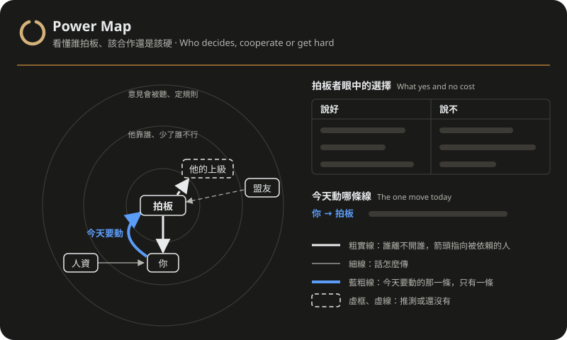

<div align="center">
  
  <h1>Power Map</h1>
  <p><b>站在你這邊的職涯策略軍師：看懂誰拍板、這局該合作還是該硬，附一張權力地圖。</b></p>
  <p>繁體中文 · <a href="README_EN.md">English</a></p>
  <a href="https://github.com/kerfnotes/skills/stargazers"></a>
  <a href="LICENSE"></a>
  
  <a href="https://www.youtube.com/@kerfnotes"></a>
</div>

## 這是什麼

Power Map 是給上班族的職涯策略軍師，高階主管也算在內，分析深度不分對象。你卡在主管、同事或跨部門的局裡，或站在接不接 offer、轉不轉行的路口，它用《Power》《Getting to Yes》《獨裁者手冊》三本書的框架幫你看局：誰真正拍板、他靠誰坐穩、誰離不開誰，再判斷這局該合作，還是該正視權力現實、走硬的路。

它站在你這邊，但不迎合。你的解讀證據不夠、被舊恩怨帶著走，或客氣到讓對方得寸進尺，它會直說，並給出根據。第一次看局附一張權力地圖，局面一眼看懂，不必在大段文字裡費力尋找。

## 你會拿到什麼

回覆的形狀跟著你要拿它做什麼走，但每份都會有：

- **結論**：這局該合作還是該硬，為什麼。
- **你可能看錯的地方**：直接挑戰你的判斷，並給出根據。
- **看局三問**：用白話問題當小標，讓你檢查它是怎麼推論的。
  1. 誰拍板、他靠誰坐穩？
  2. 他看到什麼、誰離不開誰？
  3. 對方眼中說好、說不各付出什麼，雙方的退路？

  決定在你自己手上的題目，例如接不接 offer、轉不轉行，拍板的是你，三問改為：這條路你靠誰、誰靠你、退路有多真；局裡若有其他人，他們就在這三問裡出現。

其餘看你要什麼：

- **能寄的稿，或一條路**：要今晚就寄的一段話，就給稿和它背後的判斷，並說清楚念了等於答應什麼。要決定下一步怎麼走，就給選定的策略和為何不選另外幾條、兩週內做什麼、最可能失敗在哪、真正的退路；需要時附關係人表。
- **地圖**：第一次看局附上；只要一段能寄的話時，可能省略，或只畫最關鍵的一條線。

你若列了題號，它就逐題答，開頭仍先給結論和看局。資訊不足時，它先寫明假設、把題目答完，只回問會改變答案的一兩件事。續問只更新改變了的判斷、稿和圖。

## 怎麼問

直接描述你的局面就可以。想讓它一次看清楚，照這五項寫：

```text
- 我的角色與目標：
- 底線與不願採取的手段：
- 相關人物與彼此關係：
- 事件經過：
- 已嘗試過的做法：
```

最後寫你想問什麼；問題不只一個就編號。哪一項不確定可以留空，它會先列出假設再答。

填好的例子（下方短範例的題目，照五項重排）：

```text
- 我的角色與目標：財務部，做了四年，每個月的月結報表都是我在跑，組裡只有我會。想轉到新產品組上個月開的財務分析職缺。
- 底線與不願採取的手段：暫時沒有。
- 相關人物與彼此關係：我的主管，內部轉調要他簽核。珮君，新產品組的主管。人資，負責轉調程序。
- 事件經過：人資說內部轉調要現任主管簽核，職缺月底就截止。
- 已嘗試過的做法：跟珮君聊過，她說：「我們很歡迎，你那邊放人就可以。」跟主管提了，他說：「你現在走，月結誰跑？等明年再說。」

我該怎麼讓主管放人？
```

## 範例

兩份完整回覆，各附一張地圖（HTML 檔，用瀏覽器開啟）：

- [主管不放人](references/examples/short-boss-wont-release.md)（[地圖](references/examples/short-boss-wont-release.html)）：只描述局面、問一句「怎麼讓他放人」。看三問怎麼推導出結論、為什麼先合作，以及最硬的一步怎麼留成第二步。
- [前主管要內部底稿](references/examples/long-rival-vp-wants-worksheets.md)（[地圖](references/examples/long-rival-vp-wants-worksheets.html)）：列了八個問題、附上自己的稿。看逐題答之前怎麼先給結論和看局、怎麼直接挑戰他的判斷、怎麼修改他的稿。

## 地圖長什麼樣

<div align="center">
  
</div>

形狀可以換，讀法不變。位置帶有資訊：越靠近圓心，對拍板越有份量。節點只放名稱，判斷寫在線上和旁邊。粗實線是誰離不開誰，細線是話怎麼傳；藍色粗線是今天要動的那一條，只有一條；虛框、虛線是推測或還沒發生的。拍板者旁一張小表，列他眼中說好、說不各付出什麼，要改的往往是這張表。有對手的局畫同心圓，拍板者在圓心；接不接 offer 這類職涯決定，改畫你靠誰、誰靠你、退路有多真。地圖存成 HTML 檔，放在工作目錄的 `power-map/`。

## 三本書

| 書 | 作者 | 版本 | 看局時對應哪一問 |
| :--- | :--- | :--- | :--- |
| 《The Dictator's Handbook》（《獨裁者手冊》） | Bruce Bueno de Mesquita、Alastair Smith | 2011 | 誰拍板、他靠誰坐穩 |
| 《Power: Why Some People Have It and Others Don't》 | Jeffrey Pfeffer | 2010 | 他看到什麼、誰離不開誰 |
| 《Getting to Yes: Negotiating Agreement Without Giving In》 | Roger Fisher、William Ury、Bruce Patton | 第三版（2011） | 說好、說不各付出什麼，雙方的退路 |

skill 裡附了三本書的分析工具整理（[books.md](references/books.md)）、269 筆有完整情節的書中故事（[stories.md](references/stories.md)），以及 712 筆一句話的案例索引（[case-library](references/case-library/index.md)）。都是自行撰寫的摘要，不是原文，使用時不需要原書。書名和術語只在帶來你自己想不到的洞見時出現，不逐書摘要。

來源只有這三本書。若你點名別的書，例如《Managing with Power》，它會用一般知識回答，並註明這不在 skill 的來源內。

## 交給 agent 安裝

把這段交給 Codex 或 Claude Code：

```text
請把 https://github.com/kerfnotes/skills 裡的 Power Map（skills/kerf-power-map）安裝到目前專案。
先讀 skills/kerf-power-map/docs/install.md，依目前使用的 agent 選擇安裝路徑，
完成檢查後回報安裝路徑、來源 commit 及檢查結果。
```

Codex 的專案路徑是 `.agents/skills/kerf-power-map/`；Claude Code 是 `.claude/skills/kerf-power-map/`。整個 `skills/kerf-power-map/` 資料夾就是 skill，只有 Markdown 與 HTML 檔，不需要額外工具、模型或 API key。[agent 安裝指引](docs/install.md)說明下載、已裝過舊版時怎麼辦，以及完成檢查。

也可以用 [`skills`](https://www.npmjs.com/package/skills) CLI 從整個 repo 挑選：

```sh
npx skills add kerfnotes/skills --list
```

安裝後直接描述你的局面即可。Codex 也可明確使用 `$kerf-power-map`，Claude Code 可用 `/kerf-power-map`。

分析只根據你提供的資訊，看不到對方的想法與組織內情；這是策略思考的輔助，不是法律、人資或心理諮商意見。

授權：[MIT](LICENSE)。
