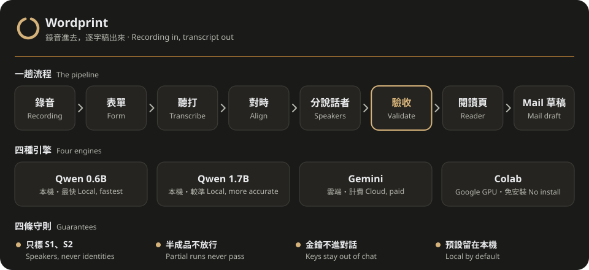

<div align="center">
  
  <h1>Wordprint</h1>
  <p><b>錄音進去，「誰在幾秒說了什麼」出來。</b></p>
  <p>繁體中文 · <a href="README_EN.md">English</a></p>
  <a href="https://github.com/kerfnotes/skills/stargazers"></a>
  <a href="LICENSE"></a>
  
  <a href="https://www.youtube.com/@kerfnotes"></a>
</div>

<br/>

<div align="center">
  
</div>

## 為什麼

會議錄音轉成逐字稿，難的不是聽打，是之後那幾步：誰說的、在第幾秒、能不能點回去聽、摘要有沒有亂寫決議。Wordprint 把這整段做成一條流程，交給 Codex 或 Claude Code 跑。檔案和要求已說清楚時直接開始；需要補資料時，才開 kerf 品牌表單，預填你已說過的選項。最後交出一頁可以點字回聽的閱讀頁。

輸入頁、逐字稿、摘要 HTML 與 PDF 統一採用 [Clayprint](../kerf-clayprint/) 的淺色設計，錄音清單操作沿用 Kerfwave。按「讀取語音備忘錄」挑選這台 Mac 的錄音，或選檔、從 Finder 拖入音檔；所有來源都能在同一份清單移除、排序及選擇合併。拖入的檔案先保存到本次工作的本機目錄，每檔上限 1 GiB，更大的檔案可用原生選檔。語音備忘錄尚未在這台 Mac 可用或無法讀取時會直接標示，詳見[匯入與保存說明](references/workflow.md#adding-recordings)。

預設全部在本機處理。只有你明確選 Gemini 才會上傳到 Google（計費，上傳前會先告訴你，轉完即刪除 Google 端的檔案）；選 Colab 則是你用自己的 Google 帳號開筆記本，在 Google 的 GPU 上跑，本機免裝模型，也不需要 Hugging Face 帳號。

## 它做什麼

| 步驟 | 做什麼 | 由誰負責 |
| :--- | :--- | :--- |
| 開始 | 已知選項直接執行；缺資料才開 kerf 表單，保留模型、來源與摘要等既有選擇 | `run.py`、`form.py` |
| 健檢 | 檢查工具與模型，`--fix` 自動補齊例行安裝；只有密碼、帳號、權限這類事留給你，一次一件 | `doctor.py` |
| 聽打與對時 | Qwen3-ASR 轉文字（本機預設 0.6B，可選 1.7B），Qwen ForcedAligner 標出每個字的時間 | `qwen_worker.py`、`torch_worker.py` |
| 分說話者 | Apple Silicon 用 Community-1，其他電腦與 Colab 用 NVIDIA Nemotron（最多 8 人，不需 token）；一律先標說話者 1、2 | 同上 |
| 驗收 | 對檔案雜湊、文字是否被改動、完成旗標；缺說話者的半成品不能當成完整稿交出 | `transcript.py validate` |
| 閱讀頁 | 繁體 `transcript.html`（OpenCC 轉換），連續閱讀，點文字回聽，時間完整時另附 `transcript.srt` | `transcript.py render` |
| 摘要 | 依會議、訪談、演講模板寫 `notes.md`，決議只收明確同意的事；有裝 [Clayprint](../kerf-clayprint/) 就再排成 `notes.html` 與 PDF | agent |
| Mail 草稿 | 只打開草稿讓你檢查，不會自動寄出；附閱讀頁與摘要，不附音檔 | `mail_draft.py` |

也可以合併多段錄音、替既有逐字稿補上說話者，或在確認姓名後改標。階段續跑會核對來源與設定，將已完成的辨識或對時成果帶入新目錄，只補缺少的階段；舊成果保留。

## 四種引擎

| 引擎 | 在哪跑 | 速度與品質 | 要付出什麼 |
| :--- | :--- | :--- | :--- |
| `qwen-0.6b` | 你的電腦 | 預設，速度優先 | 需快取所選模型 |
| `qwen-1.7b` | 你的電腦 | 可選，準確度優先 | 需快取所選模型 |
| `gemini-3.5-transcribe` | Google 雲端 | 最快、最準 | 音檔上傳並計費，轉完刪除 |
| `colab` | Google Colab GPU | 同 Qwen（預設 1.7B） | 要登入 Google、開瀏覽器 |

速度與品質是相對描述，不是量測承諾。細節見 [engines.md](references/engines.md)。

## 設計原則

- **不猜身分。** 只標說話者 1、2。提供線索時最多標成「可能是某某」，你確認後才算定案；聲音相似不等於同一人。
- **半成品不放行。** 缺了哪一段就照實標成部分完成，交出純文字稿並說明缺什麼，不製造完成旗標。
- **金鑰不進對話。** Gemini 金鑰只讀環境變數或 Wordprint 自建的鑰匙圈項目，檢查時只確認存在，不讀內容。
- **同一種格式。** 每個引擎都交出同一份 `normalized-run.json`（見 [run-format.md](references/run-format.md)），驗收、閱讀頁和摘要只寫一次。
- **安裝即用。** 例行安裝由 agent 完成；帳號、條款與權限只請你本人處理，agent 不代為同意。

## 交給 agent 安裝

把這段交給 Codex 或 Claude Code：

```text
請把 https://github.com/kerfnotes/skills 裡的 Wordprint（skills/kerf-wordprint）安裝到目前專案。
先讀 skills/kerf-wordprint/docs/install.md，依目前使用的 agent 選擇安裝路徑，
自行完成環境檢查、模型準備與短音檔驗證，回報安裝路徑、版本及驗證結果。
```

Codex 的專案路徑是 `.agents/skills/kerf-wordprint/`；Claude Code 是 `.claude/skills/kerf-wordprint/`。安裝 skill 不會下載模型；[agent 安裝指引](docs/install.md)說明怎麼用 `doctor.py --fix` 準備本機工具、模型與驗證。Windows 沒有 Python 時，先 `winget install -e --id astral-sh.uv`，再跑 `uv run --python 3.12 scripts/doctor.py --fix`。

已經在用 [`skills`](https://www.npmjs.com/package/skills) CLI 的話，也可以從整個 repo 挑：

```sh
npx skills add kerfnotes/skills --list
```

## 開始使用

安裝完成後直接說：

```text
把這個音檔轉成逐字稿
把今天早上兩段語音備忘錄合併，分出說話者，寫一份會議摘要
```

Codex 也可用 `$kerf-wordprint`，Claude Code 可用 `/kerf-wordprint`。

## 統一入口與續跑

agent 把已知選項寫成 `request.json`，再交給 `scripts/run.py` 串接轉錄、驗證與閱讀頁。資料不足時才出現表單；`delivery.json` 列出成果、警示，以及仍需 agent 製作的摘要或 Mail 草稿。

```sh
python3 scripts/run.py --request /absolute/task/request.json --task-directory /absolute/task/job-1 --no-open
python3 scripts/run.py --request /absolute/task/request.json --task-directory /absolute/task/job-2 --resume-from /absolute/task/job-1/run-1 --no-open
```

續跑一次對應一份舊 run，使用相同音檔、順序與模型。只有進度數字、尚未保存完整辨識結果時，仍需重做該階段。分說話者失敗會保留純文字；半成品不會被輸出成完整閱讀頁。完整選項與 Colab 匯入流程見 [workflow.md](references/workflow.md)。

表單先讓你加入錄音，再展開產出與設定；預設本機 0.6B、逐字稿＋會議摘要、不建立 Mail 草稿。獨立表單的「送出設定」只保存選項；由入口開啟的「開始整理」會接續處理。「設定已送出」代表設定保存，實際階段回到對話查看。

`complete` 只代表逐字稿與閱讀頁完成，摘要和 Mail 草稿另有交接狀態。摘要由 agent 核對逐字稿後撰寫，再透過 `summary_report.py` 排成 HTML、用 Clayprint 正式工具產生並逐頁檢查 PDF；`run.py` 不會自動寫摘要。未辨識到文字時不填空摘要，部分完成或取消則交出已保存的文字與恢復方法；Colab waiting 代表等你操作筆記本。

最後先提供可用的摘要與逐字稿，再集中列出實際存在的 PDF、文字與字幕。單獨帶走 `transcript.html` 仍可閱讀、下載文字；要回聽，請保留同資料夾的 `playback.wav`。未產生的 PDF／字幕不會列成下載項目；Mail 未確認建立前仍是待處理。

## 驗證狀態

| 項目 | 狀態 |
| :--- | :--- |
| Apple Silicon Mac：表單、語音備忘錄、MLX 轉錄、說話者 | 已驗證 |
| Gemini 真實 API 呼叫（6 秒兩人合成音） | 已驗證一次 |
| Colab T4 GPU：1.7B、Nemotron 兩位說話者 | 已驗證一次（短合成音） |
| PyTorch 路線（Windows、Linux、Intel Mac 用） | 在 macOS 以同一份程式驗證；Windows 與 Linux 實機未測 |
| 長錄音、多人說話的速度與準確度 | 未測 |
| Mail 真實建立草稿 | 已驗證一次：三個合成文字／PDF 附件、空收件人，未寄出 |

## 已知限制

- 讀語音備忘錄需要給終端機「完整磁碟取用權」；不想給，就把備忘錄拖到資料夾再選路徑。
- 若 macOS 詢問是否允許控制 Mail，要你本人按允許；不同執行宿主可能需要各自授權。
- Gemini 金鑰要你自己用 `security add-generic-password -s kerf-wordprint-gemini -a wordprint -w` 存進鑰匙圈（Windows 改設 `GEMINI_API_KEY` 環境變數）。
- 沒有 GPU 時，PyTorch 路線處理長錄音很慢。
- 結構檢查只確認時間涵蓋、文字未被改動與標記一致，不代表辨識正確；重要內容仍須回聽。說話者分群是模型推測，不是身分證明。

授權：[MIT](LICENSE)。模型各有授權，見[安裝指引](docs/install.md)。
